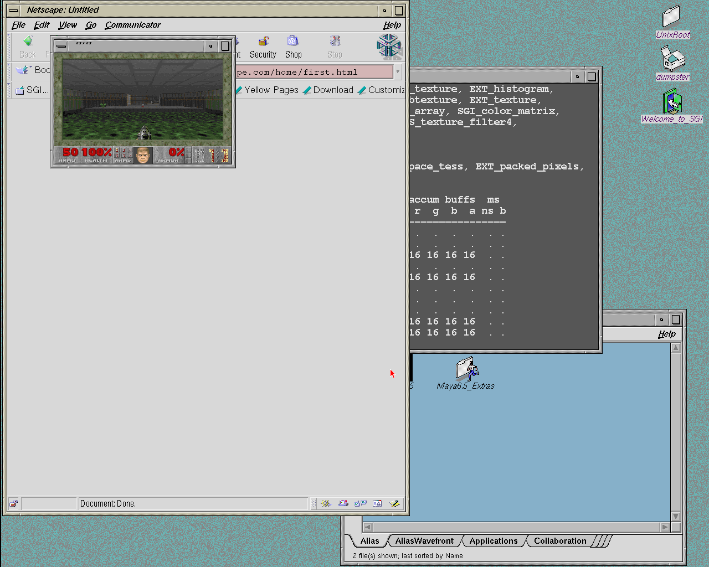
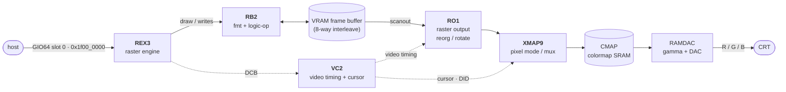

# Newport graphics board (overview)

> Intro: the Indy "XL" graphics board on GIO64 slot 0 (phys `0x1f000000`; REX3 registers at
> `0x1f0f0000`). **Henry runs it on silicon** as an ARM-served device: the PL captures every
> REX3 access into a ring and the Zynq ARM runs a software model of the board, and IRIX reaches
> the 4Dwm desktop. See **[Newport on henry](../newport-on-henry.md)** for the design,
> screenshots and known issues. The pages in this section describe the SGI hardware.

*IRIX 6.5 4Dwm on henry (Ultra96-v2), Newport served by the ARM; Doom in a window.*

> **Software side:** what IRIX's Xsgi, `ng1` kernel driver and GL libraries actually do to this
> hardware (store widths, polling, pixel DMA, context switch) is in
> [How IRIX drives Newport](irix-software.md).

> **The Indy had two graphics options.** This page covers **XL / Newport** (host geometry, raster-only).
> The other was **Express / XZ** — a hardware-geometry pipeline (SIMD Geometry Engines + a hyper-pipelined
> Raster Engine); see [Express / XZ](express-xz.md). For a Henry graphics path, Newport is the far smaller
> target — Express adds a microcoded SIMD FP array and a command-FIFO front-end on top of a REX3-class
> rasterizer.

Newport is the entry-level (8-bit, upgradable to 24-bit) framebuffer graphics board for the SGI Indy.
SGI's own tagline for it was "the least graphics you'll ever need." There is **no geometry/transform
ASIC** — the host MIPS FPU is the geometry engine, and Z-buffering lives in host system memory. The
board is purely a 2D raster engine plus a framebuffer and the video-output backend. That makes it a
smaller (but still large) target than a full GE-class SGI pipe: the bulk of the work is REX3's drawing
command set, not a 3D pipeline.

## Board architecture

Five ASIC types (plus VRAM, a colormap SRAM, and an external RAMDAC) form a one-way pixel pipeline from
the host bus to the CRT. REX3 is the only host-facing chip; everything downstream is display/scanout.

Flow: **host → REX3** (programs primitives over GIO64) **→ framebuffer** (REX3 reads/writes VRAM
through RB2, which holds the read/write formatters + LogicOp) **→ RO1** (reads the VRAM serial/video
ports, merges overlay+color, undoes REX3's scanline stagger) **→ XMAP9** (selects pixel mode: RGB vs
color-index, picks the display ID) **→ CMAP** (colormap SRAM, in CI mode) **→ RAMDAC** (gamma + analog
RGB) **→ CRT**. **VC2** sits to the side as the video-timing/cursor/DID generator, driving sync/blank timing and the
per-pixel cursor + display-ID streams (to XMAP9); it is *not* in the pixel datapath but gates it. REX3 owns the
**Display Control Bus (DCB)**, an 8-bit side channel it uses to program VC2/XMAP9/RAMDAC (and read back).

## Address & host interface

Newport is the GIO64 **slot-0** device, based at phys `0x1f000000` (4 MB aperture). **REX3 is the only
host-programmable chip**: it is a GIO64 bus slave whose registers sit at **slot base + `0xF0000`**
(`0x1f0f0000`; rex3.pdf p.20 gives the base as `0x1FnF0000`, and MAME maps `0x1f0f0000–0x1f0f1fff`).
Pixel PIO/DMA goes through the `HOSTRW` registers, not a separate memory window. REX3 forwards config
to the rest of the board over the DCB. The GIO bus interface runs at 33 MHz behind a 64-wide × 32-deep
host FIFO; the framebuffer side is an 8-way interleaved VRAM running at 66 MHz.

**Detection.** Newport has **no** GIO64 Product Identification Word at its slot base. Linux
(`arch/mips/sgi-ip22/ip22-gio.c`) first checks for Express (HQ2 `MYSTERY` register at slot + `0x6A07C`
reading `0xDEADBEEF`), then for a product-ID word, and finally treats a readable REX3 `USER_STATUS`
(slot + `0xF133C`) as "Newport present". How IRIX's own `ng1` driver probes is not documented here. See
[../peripherals/gio64.md](../peripherals/gio64.md) for the GIO64 slot/address map.

## The chips at a glance

| Chip   | Role                                                              | Doc                  | Pages |
|--------|-------------------------------------------------------------------|----------------------|-------|
| REX3   | Raster/rendering engine; host-facing GIO64 slave; DCB master      | [rex3.md](rex3.md)   | 149   |
| VC2    | Video timing generator, hardware cursor, display-ID (DID) encoder | [vc2.md](vc2.md)     | 42    |
| XMAP9  | Pixel-mode mux / colormap-index path (RGB vs CI, display IDs)      | [xmap9.md](xmap9.md) | 34    |
| RB2    | RAM Buffer: framebuffer read/write formatter + LogicOp (VRAM glue) | [rb2-ro1.md](rb2-ro1.md) | 16 |
| RO1    | ReOrganizer: VRAM serial-port readout, overlay merge, de-stagger  | [rb2-ro1.md](rb2-ro1.md) | 15 |

(CMAP is a colormap SRAM and the RAMDAC is an off-the-shelf part; neither has its own page here.)

## Henry relevance

**Implementation: an ARM-served model, working on silicon.** No Newport chip is built in the PL.
`rtl/gio_window.sv` turns every access to the REX3 window (`0x1f0f0000–0x1f0f1fff`) into a
record in a DDR capture ring, and holds loads until the ARM answers. On the Zynq ARM, the driver
runs `sgi_newport` (a condensed MAME `newport.cpp`, shared with
[indysim](https://github.com/dsheffie/indysim)) and shows the framebuffer on an X display viewed
over VNC. The MC's graphics DMA (VDMA, memory → GIO) is a channel of henry's DMA engine and
feeds the same ring. The vertical-retrace interrupt is an ARM-driven INT3 `local1` level.
Details: [Newport on henry](../newport-on-henry.md).

Why this split: the 2026-10-02 feasibility study (`NEWPORT_FEASIBILITY.md`, QEMU traces of
IRIX 6.5) found IRIX's stream is ~99.9% posted writes. Serving every access on the ARM was
3–10× too slow, a REX3 rasterizer in the PL did not fit henry's LUT budget, and the hybrid (PL
logs writes, ARM draws) was feasible. Any design needed MC graphics DMA and a retrace interrupt;
henry has both.

What the generic Newport work turned out to be (in the order it was needed):

1. The probe: a readable REX3 window → `hinv` reports "Graphics board: Indy 8-bit" (or 24-bit).
2. The REX3 register file, the DCB devices (VC2, XMAP9, CMAP, RAMDAC) with correct readback, and
   the drawing command set (spans, lines, blocks, host data). This comes from MAME's model.
   Two bugs that MAME has, CID match in `CLIPMODE` and per-plane write masks, showed up only once
   a real desktop ran (see [Newport on henry](../newport-on-henry.md#two-model-bugs-found-on-silicon)).
3. Scanout is not rebuilt as chips: the ARM reads the framebuffer directly and applies the
   CMAP/XMAP9 mode state.
4. MC VDMA and the retrace interrupt.

## Sources

- REX3 Specification, Rev 1.0 (SGI, Aug 1993) — `sgi/docs/indy_docs/newport/rex3.pdf` (§1.4 Newport
  architecture, §1.5 REX3 architecture, §3 programmer interface, §4 system interface).
- VC2 Specification, Rev 2.0 (SGI, May 1993) — `…/newport/vc2.pdf` (§2.1 system block diagram).
- XMAP9 Specification, Rev 2.1 (SGI, Oct 1993) — `…/newport/xmap9.pdf` (§1.2–1.4, Newport block diagram).
- RB2 (RAM Buffer) Specification, Rev 2.3 (SGI; page footers dated 2000) — `…/newport/rb2.pdf` (§1.2 general description).
- RO1 (ReOrganizer) Specification (SGI) — `…/newport/ro1.pdf` (§1–2 functional description).
- Henry GIO64 peripheral notes — [../peripherals/gio64.md](../peripherals/gio64.md) (slot map).
- Linux `arch/mips/sgi-ip22/ip22-gio.c` (v6.12) — `ip22_check_gio()`: HQ2 `MYSTERY` / Newport `USTATUS`
  probe offsets.
- MAME `src/devices/bus/gio64/newport.cpp` — REX3 window `0xf0000–0xf1fff` within the slot.
- Henry RTL: `rtl/gio_window.sv` (the ARM-served window), `rtl/dma_engine.sv` (VDMA channel),
  `rtl/mc.sv` (DMA TLB/CTL registers), `rtl/henry_soc.sv` (decode, INT3 wiring).
- `NEWPORT_FEASIBILITY.md` (repo root, 2026-10-02 study; not published) — IRIX access-stream
  measurements and the ARM/hybrid/PL comparison.
