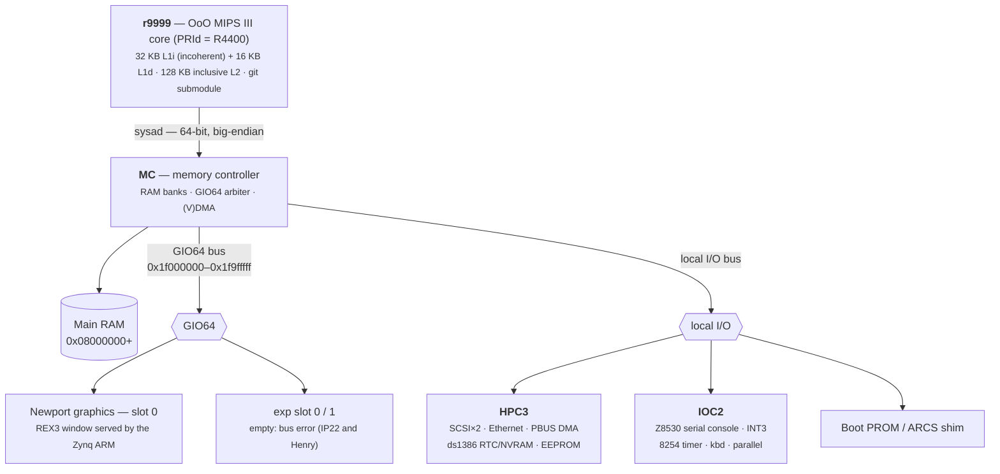

# Henry — the wannabe IP22 SoC

**Henry** is a from-scratch, FPGA/RTL **System-on-Chip** that impersonates the SGI **Indy** (board code
**IP22**) closely enough to boot **IRIX 6.5.22**. It is built around the **[r9999](https://github.com/dsheffie/r9999)**
out-of-order MIPS III core — it presents itself to software as an **R4400** (`PRId 0x0440`) — included here as a git
submodule, plus a set of re-implemented IP22 peripheral blocks.

> **Why "Henry"?** The SGI **Indy** is named for **Indiana Jones** — whose real name is **Henry** (Walton Jones Jr.;
> "Indiana" was the dog). Henry is a machine that answers to a name that isn't quite its own: a *wannabe* IP22.

This site is the **platform specification and implementation reference**: the address map, each peripheral block's
register interface and "minimum to boot" subset, the ARCS firmware shim, the IRIX boot/console contract, and the
cache/coherence/TLB rules the CPU must honor. Every claim is **cross-validated against MAME** booting the real Indy
IRIX image — MAME is Henry's **golden reference model**, and the values captured from it are the block-level test
vectors. Tags: ✅ = confirmed in MAME, ⚠️ = a correction to an earlier reverse-engineering finding.

## The system at a glance

## Canonical physical address map (IP22 / Henry)

| Physical range | Size | Block | Henry notes |
|---|---|---|---|
| `0x00000000–0x0007ffff` | 512 KB | **RAM alias** | aliases `0x08000000`; holds the exception vectors (`0x0`, `0x80`) — remapped in `henry_soc.sv` before DRAM arbitration (CPU accesses only) |
| `0x08000000–0x17ffffff` | 256 MB | **Main RAM** (MC banks) | base of physical DRAM; sized via MC MEMCFG (Henry's `mc.sv` reset value describes **128 MB**; the `henry_arcs` FSBL reprograms MEMCFG0 to 256 MB, which is what IRIX sees) |
| `0x18000000–0x1effffff` | 112 MB | reserved | IP22: bus-error. Henry: not decoded — passed to the AXI port; outside the DRAM window reads return a `0xA5A5…` poison pattern and writes are dropped, with **no** bus error |
| `0x1f000000–0x1f9fffff` | 10 MB | **GIO64 bus** | graphics @`0x1f000000`; exp slots @`0x1f400000`/`0x1f600000`. **Henry:** the REX3 window `0x1f0f0000–0x1f0f1fff` is an ARM-served Newport ([Newport on henry](newport-on-henry.md)); the rest of GIO space is empty and, with `CPUCTRL1.ABORT_EN`, a load takes a precise data bus error ([Bus errors](bus-errors.md)) |
| `0x1fa00000–0x1fafffff` | 1 MB | **MC registers** | ⚠️ big-endian `+4/+c` register alias |
| `0x1fb80000–0x1fbfffff` | 512 KB | **HPC3** | + IOC2 @`0x1fbd9800` (serial console), ds1386 RTC/NVRAM @`0x1fbe0000`. **Henry:** the ds1386 clock registers are in `hpc3.sv`; the bbRAM (`0x1fbe0040–0x1fbe7fff`, NVRAM + station MAC) is plain DRAM the host populates. HPC3 chip 1 (`0x1fb00000–0x1fb7ffff`) is empty and bus-errors like empty GIO space |
| `0x1fc00000–0x1fffffff` | 4 MB | **Boot PROM** | DRAM-backed on Henry; the host loads the ARCS first-stage image (`henry_arcs.bin`), or the real SGI IP24 PROM (`henry_tb --prom`), here and starts the core at `0xbfc00000` |
| `0x20000000–0x2fffffff` | 256 MB | **High system memory** | kseg-mapped only → the IP22 platform's physical address space is **30-bit** (r9999 itself carries 36-bit PAs, `PA_WIDTH=36`; its TLBs store 30 PA bits, `TLB_PA_WIDTH=30`). **Henry:** used only as the PROM's memory-bank probe window: a bank whose MEMCFG base is `0x80` reaches its DRAM (banks 0/1, 128 MB each), anything else reads 0 and drops stores |

(See [Memory & address map](peripherals/mc.md) for the MC/MEMCFG detail.) Empty GIO space raises a **bus error** as
on IP22: the MC decides it, latches `GIO_ERROR_ADDR/STAT`, and returns the error with the response; r9999 takes a
precise data bus error (cause 7) on a load, and a posted store raises the MC bus-error interrupt. See
[Bus errors](bus-errors.md).

## Where to start

| If you want to… | Read |
|---|---|
| understand the whole system | this page + [Architecture](architecture.md) |
| wire r9999 in & know what to implement | [CPU integration](cpu-integration.md) |
| get IRIX to print "IRIX is alive" | [Boot & console](boot-and-console.md) + [IOC2](peripherals/ioc2.md) |
| drive an interrupt-driven serial console | [SCC implementation & Tx interrupt](peripherals/scc.md) |
| build the firmware Henry presents | [Firmware / ARCS shim](firmware-arcs.md) |
| get cache/DMA/TLB right | [Cache, coherence & TLB](coherence-cache-tlb.md) |
| implement a chip | the [peripheral specs](peripherals/mc.md) |
| follow the IRIX boot, function by function | [IRIX boot flow](irix-boot-flow.md) |
| see the graphics desktop and how it works | [Newport on henry](newport-on-henry.md) |
| understand the ARM ↔ device protocol | [ARM device protocol](arm-device-protocol.md) |
| reproduce/extend the findings | [Methodology](methodology.md) |

## Status

*As of 2026-10-25 (henry `main` `eea6ecb`, which pins r9999 `788c412`; RTL revision register still `0x20261018`). The bitstream numbers below are tagged with the bitstream they were measured on.*

Henry **boots IRIX 6.5.22 on real FPGA silicon** (Ultra96-v2, Zynq UltraScale+ ZU3EG, 100 MHz): PROM/ARCS →
IRIX kernel → SCSI disk → multi-user userspace, and now **to the 4Dwm desktop on Newport graphics**, with PS/2
keyboard and mouse. IP22 Linux boots as well.

*IRIX 4Dwm on henry silicon: the Newport board is a model on the Zynq ARM, fed by the PL. Doom is running in a
window.*

- **Graphics:** an ARM-served Newport (XL8 or XL24). The PL captures REX3 accesses into a ring
  (`gio_window.sv`), the ARM runs the board model, and MC VDMA (memory → GIO) is a channel of the DMA
  engine. Device traffic (the DMA engine, the GIO ring and the MC fill) runs on a second AXI lane, separate from
  CPU misses, with 64 B bursts for VDMA loads and ring writes (`eea6ecb`). See [Newport on henry](newport-on-henry.md).
- **Devices:** SCSI disk and Ethernet go through one DMA engine (`dma_engine.sv`) with a coherent snoop
  path and ARM staging rings, so the ARM never touches guest memory and no ARM cache flushes are needed
  ([ARM device protocol](arm-device-protocol.md)). IRIX networking (telnet, X11 over TCP) works. The staging-ring
  design passed a 24-round IRIX network/disk soak on silicon (bitstream `0e7de40d`, 2026-10-15: 1.5 GB, 0 panics).
- **Bus errors:** empty GIO space raises precise data bus errors ([Bus errors](bus-errors.md)).
- **Real SGI PROM:** the device models also run the real IP24 PROM (`henry_tb --prom <bin>`); with the
  memory-bank probe window decoded (`ae2b7ab`) it sizes memory at 256 MB on silicon.
- **I-side CACHE ops** invalidate one L1I set instead of the whole L1I: IRIX Doom under Xsgi went from 22 to
  33 fps on silicon (`b2c3193`).
- **Performance:** Dhrystone 2.1 under IRIX (MIPSpro `-Ofast -mips3`) at 100 MHz: **158.1 VAX MIPS** on
  the default big core with Newport (ROB 16, LSU 8, 128 KB L2; `7d953110`), **169.6** on the ROB 32 / LSU 12 /
  512 KB L2 build (`0e7de40d`, no Newport). The Indy R4400 at 175 MHz is listed at 125.4 and the R5000 at 150 MHz at 183.6
  ([sgistuff](http://www.sgistuff.net/funstuff/benchmarks/index.html)). FPGA resource and timing history is on the
  [FPGA stats](fpga_stats.md) page.

Implemented SoC RTL (`rtl/`): **MC** (including the DMA TLB/VDMA registers and bus-error status), **HPC3**,
**IOC2** with the **Z8530 SCC** console (Tx and Rx), the i8254 and the ARM-served 8042, the **INT3** interrupt
mux (`int3.sv`), the **ds1386 RTC** (a running clock; its NVRAM is DRAM-backed), the **DMA engine** (SCSI, ENET TX/RX, VDMA), the SCSI and ENET
shims, and the **GIO window** that serves Newport. The Verilator co-simulation harness (`sim/`, `henry_tb`, with
an ISS lock-step checker) is the pre-silicon vehicle, and [indysim](https://github.com/dsheffie/indysim) is the
Indy reference model.

The peripheral specs (MC, IOC2, HPC3, GIO64, VDMA) and the cross-cutting docs are drafted from the SGI IP22
chip documents + MAME validation. Audio (HAL2) is documented but **not** implemented.
The detailed working notes live in the [`r9999/`](https://github.com/dsheffie/r9999) submodule
(`IRIX_CPU_REQUIREMENTS.md`, `IRIX_KERNEL_GAPS.md`, `IP22_CHIP_REGISTERS.md`, `MAME_QUESTIONS.md`).
