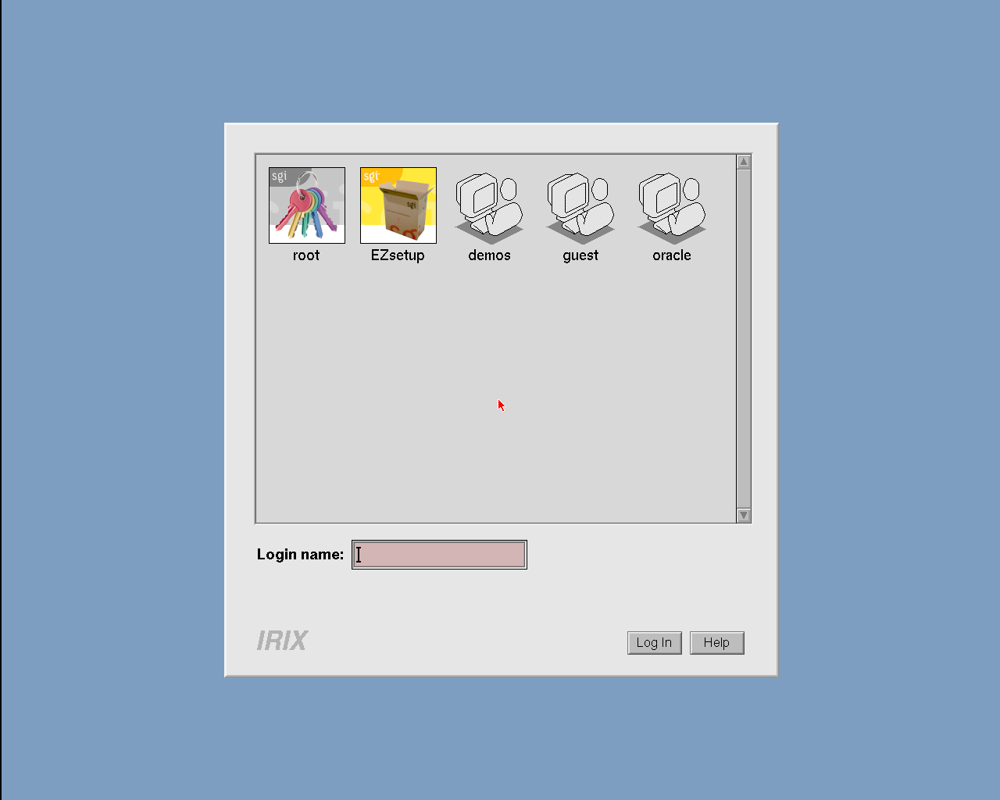
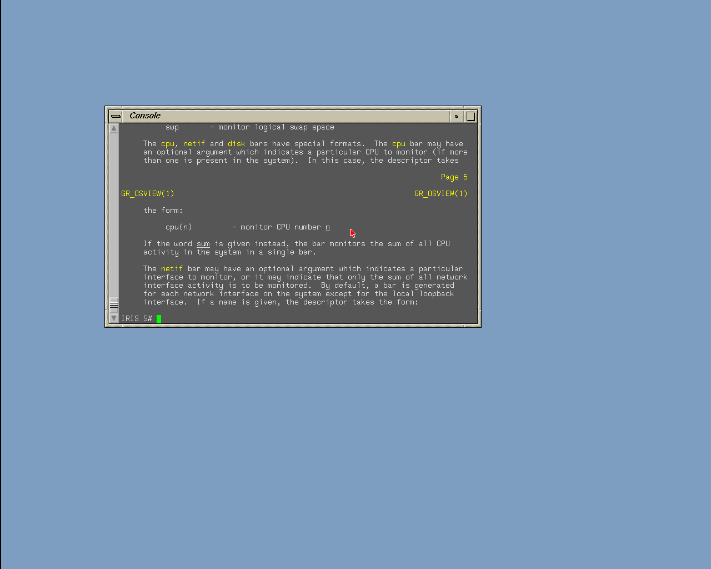
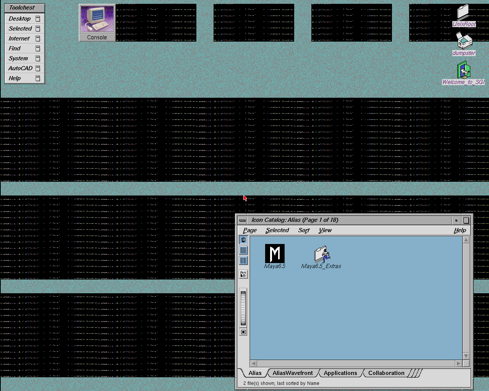
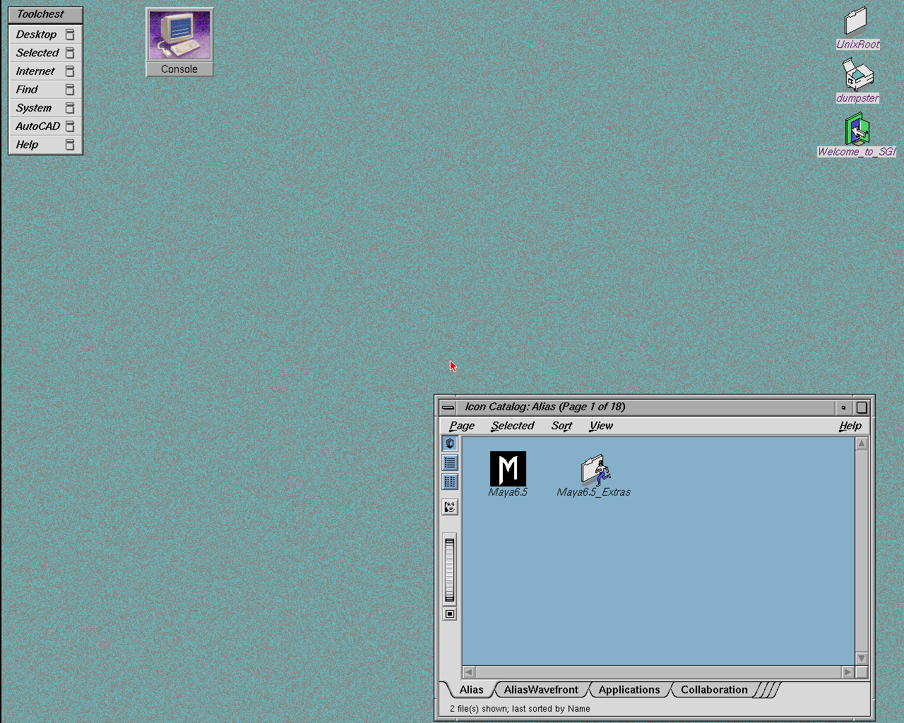
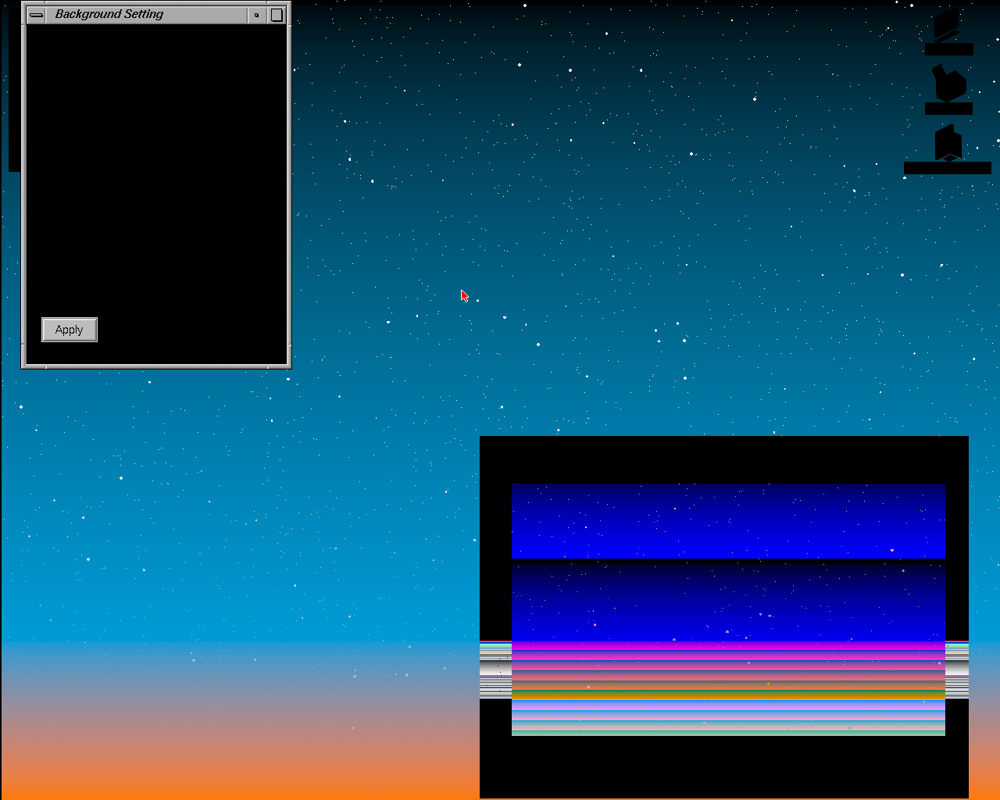
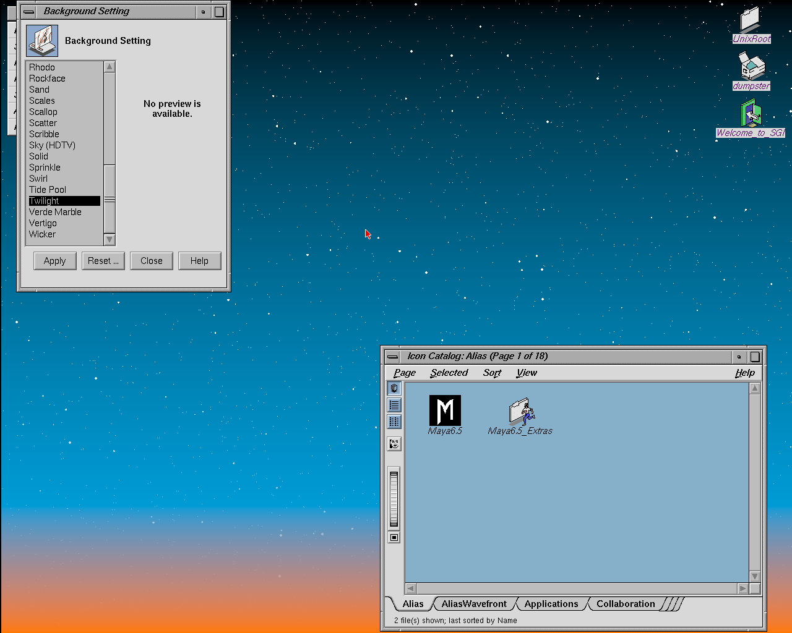
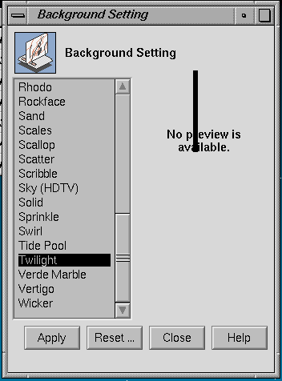
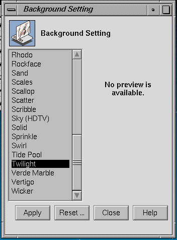

# Newport on henry: ARM-served graphics

!!! success "Status (2026-10-18): working on silicon"
    IRIX 6.5 on the Ultra96-v2 probes an Indy graphics board in GIO slot 0, Xsgi brings
    up xdm and the 4Dwm desktop, and the PS/2 keyboard and mouse work. Both board types run:
    XL8 (8-bit) and XL24 (24-bit, see [XL24](#xl24)). The desktop wallpaper, login icons and
    Doom are drawn through **MC VDMA** (memory → GIO) on the PL. Open items are listed under
    [Known issues](#known-issues).


*xdm login, captured from the board's Newport display. The user icons are image data the
X server sends with MC VDMA (mode `0x50`, memory → GIO).*


*4Dwm with Netscape, a console and Doom running in a window (big-core bitstream
`7d953110`). Doom uses VDMA heavily for its frame blits.*

{ width="640" }
*The first PS/2-enabled silicon run (2026-10-16): a console window on the XL8 desktop.*

## Design

IRIX sees an Indy graphics board (REX3 and its DCB devices: VC2, XMAP9, CMAP, RAMDAC) at
`0x1f0f0000`. The board itself is software on an ARM core: the same `sgi_newport` model
[indysim](https://github.com/dsheffie/indysim) uses (a condensed MAME `newport.cpp` plus span
kernels). The PL part is deliberately generic -- **an ARM-served GIO window** -- so the same
infrastructure carries other devices: it already serves the IOC2 **8042** keyboard/mouse
controller, and IMPACT's HQ3 command FIFO would be the same pattern at higher volume.

| | PL (`rtl/gio_window.sv`) | ARM (`gio_service.h` / `newport_arm.cc` in the driver) |
|---|---|---|
| Stores to the window | append a record to a capture ring in the staging region; posted | apply in order to the device model |
| Loads from the window | hold the CPU load; append a READ record behind all earlier stores; wait for the answer | drain the ring up to the request, run the read (side effects included: STATUS read acks retrace), post the 64-bit answer |
| MC VDMA (memory → GIO) | `dma_engine` channel `CH_V` reads memory coherently and appends `VDMA STORE` records between BEGIN/END markers | applies them as host-data writes; reports REX3 busy between the markers |
| Interrupts | drive INT3 `local1_src` (bit 7 = VRETRACE) and mappable bit 4 (8042) from an ARM-written level register | decide when lines rise and fall (vblank timer, keyboard/mouse data) |
| Flow control | ring full: hold the CPU access until the ARM frees space | doorbell its consumer index |
| Presentation | -- | the framebuffer goes to an X display on the board (`--newport-display :2`), viewed over VNC |

```
 CPU store 0x1f0f0xxx ─► gio_window ─► capture ring (staging) ─► ARM: sgi_newport ─► framebuffer ─► X :2 / VNC
 CPU load  0x1f0f0xxx ─► gio_window ─► READ record ────────────► ARM: answer ─► AXI-Lite ─► CPU
 MC VDMA   memory ─► dma_engine CH_V ─► VDMA STORE records ─────► ARM: REX3 host data
 vblank / kbd / mouse ◄─ local1_src[7] / mappable[4] ◄─ ARM-written IRQ levels ◄── ARM timers, X events
```

Ordering is the only subtle part: a read must observe every earlier write, so read requests go
through the same ring, and the ARM answers only after draining it. The CPU is blocked on the load
meanwhile (device loads already block in henry). All reads go to the ARM: about 99.9% of accesses
are posted writes, drawing paths do not read, and the remaining reads (probe, DCB readback,
STATUS, pixel readback) have side effects or need the framebuffer.

## Interface (RTL revision `0x20261018`)

The RTL revision (AXI-Lite `0x3F`) must match the driver: the driver checks it at startup
(`HENRY_RTL_REV`). Revision `0x20261018` added the VDMA record types and markers.

**Windows.** REX3 at `0x1f0f0000–0x1f0f1fff` (8 KB, including its GO alias at `+0x800`), and the
IOC2 8042 (data `0x1fbd9843`, command/status `0x1fbd9847`). The rest of GIO space bus-errors
(see [Bus errors](bus-errors.md)).

**Capture ring.** Staging `0x1E200000`, 65536 records × 16 B. Little-endian record (byte i =
bits `[8i+7:8i]`):

| bytes | field |
|---|---|
| 0–3 | `{type[31:30], mask[29:22], dwoff[21:0]}`. Type 0 = STORE, 1 = READ, 2 = VDMA STORE (mask `0xff`), 3 = VDMA MARKER (mask bit 0: 1 = BEGIN, 0 = END of one transfer). `dwoff[21]` selects the device: 0 = REX3 window, 1 = 8042. `mask` bit i = lane i valid |
| 4–7 | `recno`: running record number, **starting at 1**, assigned when the record is queued (so the ring stays in recno order); the answer-sequence register resets to 0, so 0-based numbering could falsely complete a first-record READ |
| 8–15 | `lane[0..7]`: lane i = the byte at window offset `dwoff*8 + i` |

- **Producer index** `prod` (records written) at staging `+0x60`, published after every READ
  record, whenever the queue drains, and periodically. Record `n` lives in slot `(n−1) mod 65536`.
- **Ring full** (`assigned − cons == 65536`): the PL holds the CPU's access. The DMA is never held
  (see [VDMA](#mc-vdma-memory-gio)).
- One memory port (arbiter master 2); staging addresses are not snooped.

**AXI-Lite (S00):**

| reg | ARM write | read (debug) |
|---|---|---|
| `0x20` | read answer lanes 0–3 (lane 0 in bits 7:0) | `prod` |
| `0x21` | read answer lanes 4–7 | `{pending, pending_recno[30:0]}` |
| `0x22` | answer sequence = the READ record's `recno`; completes the held load (write `0x20`/`0x21` first) | VDMA usage: `{non-fill starts, last mode}` |
| `0x23` | `cons`: records consumed | VDMA usage: `{fill starts, other DMA register writes}` |
| `0x2A` | IRQ levels: bits 7:0 → INT3 `local1_src` (7 = VRETRACE); bit 8 → mappable 4 (8042) | -- |

## MC VDMA (memory → GIO)

IRIX does not use VDMA to reach the xdm login (0 transfers), but every image put after it does:
the wallpaper tiles, the login icons, and application blits (Doom). All of it is mode `0x50` --
memory → GIO, upward. Without VDMA the wallpaper was REX3 drawing noise from an empty host-data
path.

- **Engine:** channel `CH_V` (3) of `rtl/dma_engine.sv`, the one DMA engine henry's devices share.
  Memory reads go through the coherent snoop shim, so no cache flush is needed. Each 8-byte group
  becomes a `VDMA STORE` record. The CPU is never held for a transfer: an early version held CPU
  accesses during the DMA and deadlocked, because the held access kept the L1D from answering
  the DMA's snoops. Instead the transfer is bracketed by BEGIN/END markers, and the ARM behaves as
  REX3 does during a host-data DMA: it reports busy between the markers and applies CPU stores only
  after END. (In practice Xsgi waits for each transfer, so no CPU store has landed inside one.)
- **Translation:** the MC DMA TLB (4 entries, 4 MB each, registers `0x180–0x1bc`) plus a leaf PTE
  load, with the last page cached. **The PTE page is `TLB_LO[25:6] << 12`.** MAME masks the entry
  with `0x003fffc0`, which drops `lo[25:22]`. That only works while the page tables sit below PA
  `0x10000000`: IRIX's sit higher, so MAME (and our first version) read zeros and sent every page
  to PA 0. The fix went into the RTL and indysim at the same time.
- **Completion:** final `MEMADR` written back; `DMA_COUNT`, zoom and stride exactly as indysim's
  `dma_perform`; with `DMA_CTL` bit 4 set, completion raises INT3 `local0` bit 4.
- **Not modeled:** the GIO → memory direction, fill mode and the `0x2070` start alias complete at
  once without moving data. IRIX has not used them so far.

{ width="49%" }
{ width="49%" }
*indysim, same boot: wallpaper tiles with MAME's TLB_LO mask (left, every page translated to
PA 0) and with `lo[25:6]` (right, matches the real-X reference).*

Validation: `sim/vdma_test` (the RTL engine against a copy of indysim's `dma_perform`, 3000
random transfers × 6 seeds, 4 of 4 injected mutations caught); `tests/vdma` bare-metal in
`henry_tb` with `GIOLOG=1` + `check.py` (39/39 doublewords, IRQ, CAUSE and MEMADR). DMA test
buffers must be at PA ≥ `0x08000000`: the IP22 low alias at PA 0 is CPU-side only, so DMA there
reads zeros.

## Two model bugs found on silicon

Both bugs were in the Newport model (inherited from MAME), not the RTL. Both fixes are in all
three copies of `sgi_newport.cc`: indysim, `sim/newport` and the driver.

**REX3 CID match (window composition).** Switching the wallpaper to *Twilight* turned windows
black and smeared the icon catalog. Xsgi marks the root window's visible region with clip ID 1
(auxiliary-plane bits `[1:0]`), and Twilight draws full-screen with `CLIPMODE` CID match 2, so the
CID test is what keeps the wallpaper behind the windows. The model had no `CLIPMODE[12:9]` CID test.
The first fix covered `clip_pass` but missed the separate clip copy in the `span_fast` kernel; time
bisection of the replayed trace found the second site.

{ width="49%" }
{ width="49%" }
*Left: captured on the board before the fix. Right: the board's own `NEWPORT_TRACE` replayed
through the fixed model (indysim `tools/np_replay`).*

**Per-plane write mask (the black bar).** A black bar appeared in the Background panel's preview
area. Pop-up-plane writes (planes = 5) replicate across byte lanes, and without a per-plane mask
they landed in the overlay byte (Xsgi uses `WRMASK 0xffffff`). Fix: `plane_mask()` in
`sgi_newport.hh` (CID `0x33`, PUP `0xcc`, OLAY `0xffff00`), applied in `rb_store` and `span_fast`.
Replay changes only the bar.



*Replayed board trace: CID fix only (left) and with the plane mask (right).*

## Keyboard and mouse

The IOC2 8042 is served by the ARM through the same window (`dwoff[21] = 1`), with its interrupt
on INT3 mappable bit 4. PS/2 mice are relative, so the driver turns X pointer motion into deltas.
Motion with unchanged buttons is coalesced into the newest unsent packet, and the pointer is
re-synced at screen edges (`EDGE_PUSH`). Turning off pointer acceleration in IRIX makes tracking
much better, but the IRIX cursor and the host pointer still drift apart over time (see
[Known issues](#known-issues)).

## XL24

IRIX supports both board types. The XL24 (24-bit) takes its video timing from the `monitor`
environment variable, so the ARCS shim must answer `GetEnvironmentVariable("monitor")` with
`"h"` (`henry_arcs` `fb449a50`, r9999 `c2a5898`); without it IRIX picks 1024×768. Run the driver
with `NEWPORT_XL24=1`. The CMAP revision byte's upper bits are the **board** revision (`0xa1` =
XL8 rev 2, `0x02` = XL24 rev 0), so do not "fix" the monitor ID there: `0xa2` turns the board back
into an 8-bit one. The framebuffer (RB2) pitch is 1344 pixels and its height 1088.

## Debugging the model

Rendering bugs are found offline, not on the board:

1. On the board, `NEWPORT_TRACE=<file>` records every REX3/DCB access the guest makes, with
   timestamps.
2. `tools/np_replay` in indysim replays the trace through the model. `NEWPORT_PPM` writes the
   framebuffer, `NP_AUXDUMP` writes the auxiliary planes (CID/PUP/overlay), and
   `--hi <monotonic ns/10>` stops at a point in time.
3. `NEWPORT_DRAWCAP` logs the words each GO touches, which pins a bad pixel to one command.
4. Bisect on time until the first wrong frame, then on the command that draws it.

The replay is bit-exact on x86 and the A53, so a fix that makes the replay right is right on the
board.

## Running it

- Bitstream with `gio_window` + VDMA (RTL revision `0x20261018`) and a matching driver
  (`mips-axi` from the driver's Newport branch). Start the guest with `--newport-display :2` (and
  `NEWPORT_XL24=1` for 24-bit).
- Current recommendation: `NP_NO_GFXBUSY=1`, see below.

## Building without graphics

`DISABLE_NEWPORT` (e.g. `SV2V_DEFINES="ENABLE_DEBUG_WATCHPOINT DISABLE_NEWPORT" ./gen_mipscore.sh`)
builds henry as an Indy with no graphics board:

- the REX3 window is not decoded, so it times out like the rest of empty GIO (a bus error
  with `CPUCTRL1.ABORT_EN`); IRIX and Linux probe the slot, find nothing, and come up on
  the serial console;
- the Newport interrupts (INT3 local1, including VRETRACE) are tied off, so the ARM model
  cannot raise them;
- MC VDMA is removed, since only Newport uses it: memory → GIO starts complete at once
  without moving data, and `dma_engine`'s VDMA channel is pinned idle so synthesis drops it;
- the 8042 keyboard/mouse still goes through `gio_window`.

The RTL revision is unchanged, so the same driver runs both builds; leave off
`--newport-display`.

## Known issues

- **GFXBUSY:** reporting REX3 busy during VDMA (the faithful behaviour) correlated with IRIX
  bus-error panics. Runs with `NP_NO_GFXBUSY=1` have been stable; the root cause is not found.
- **Cursor drift:** see [Keyboard and mouse](#keyboard-and-mouse). The planned fix is to close the
  loop on the VC2 cursor position.
- **VDMA lane packing for an unaligned start** (`memadr & 7` = `gioadr & 7` ≠ 0) follows indysim
  (packed from lane 0) and has not been checked against hardware.
- **Speed:** the A53 model is about one core at ivview rates (~5.85 µs per GO, 87% of it pixel
  work). Doom over Newport is slower than the same desktop forwarded as X11 over the network, and
  `top` shows most of the time in Xsgi.

## History and decisions

- 2026-10-02: feasibility study (`NEWPORT_FEASIBILITY.md`). Serving every access on the ARM was
  judged too slow; posted writes plus an ARM-side model was judged feasible.
- 2026-10-16 (dsheffie): all reads ARM-served to start; presentation as an X11 window on the board;
  the model is copied into the project (as `ring_service.h` is shared today). First silicon desktop
  on the TINY_CORE build, then PS/2.
- 2026-10-17: MC VDMA channel, TLB_LO fix, ring markers (revision `0x20261018`), XL24.
- 2026-10-18: CID match and plane-mask fixes; big-core bitstream with Newport; Doom.
