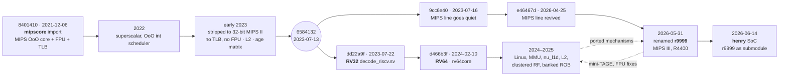

# r9999 lineage: MIPS → RISC-V → MIPS

*r9999 did not start as a fresh MIPS design for Henry. The core began as a MIPS out-of-order design, was turned into a 32-bit RISC-V core, grew into the 64-bit [`rv64core`](https://github.com/dsheffie/rv64core) (where most of the microarchitecture work happened), and was then picked up again as a MIPS core. This page traces that path from git history. Every milestone cites a commit hash and its author date.*

## One root, three repositories

[`mipscore`](https://github.com/dsheffie/mipscore), [`rv64core`](https://github.com/dsheffie/rv64core) and [`r9999`](https://github.com/dsheffie/r9999) all share the same root commit, **`8401410` "initial import for github" (2021-12-06)**. They are one history that split into two lines in July 2023:

- **`6584132` (2023-07-13, "remove references to state64")** is the last commit common to both lines.
- The **RISC-V line** starts nine days later with `dd22a9f` (2023-07-22). It was developed on mipscore's `rv32` branch and continues as `rv64core` `main`.
- The **MIPS line** got one more commit, `9cc6e40` (2023-07-16), then sat untouched until **`e46467d` (2026-04-25)**. That line became r9999. mipscore's `new-origin` remote points at the r9999 GitHub repo, and the README was renamed from `mipscore` to `r9999` in `5da40e1` (2026-05-31).

So r9999 is **not a fork of rv64core**. It is the MIPS sibling that stopped in 2023. Mechanisms built in rv64core since then were **hand-backported**: re-implemented in r9999 from the rv64core source, not inherited through git.

## Era 1: MIPS origins (2021–2023)

The first import was already an out-of-order MIPS core. The README added a week later (`d1fe341`, 2021-12-13) describes a "pedagogical SystemVerilog model for a decoupled MIPS CPU" that "aspires to be used in either a FPGA implementation of a SGI workstation or N64". The tree has `decode_mips32.sv`, an FPU (`fpu.sv`, `fp_add.sv`, `fp_mul.sv`, `fp_div.sv`), a TLB (`tlb.sv`, `utlb.sv`), L1I/L1D, and a C++ golden ISS (`interpret.cc`, `interpret64.cc`). That ISS uses the same `execMips`/`execSpecial`/`mkMonitorVectors` structure as [`interp_mips`](https://github.com/dsheffie/interp_mips) (first commit `189583a`, 2014-05-22). There was a separate C++ out-of-order MIPS model in 2017 (`mips-cpp-uarch-model`, `57442b1`, 2017-09-23), but it does not share history with the RTL.

| Date | Commit | Milestone |
|---|---|---|
| 2021-12-06 | `8401410` | Initial import: scalar renamed, decoupled MIPS core with FPU and TLB |
| 2021-12-29 | `8753f94` | Hit-under-miss L1D |
| 2022-01-22 | `0948eac` | First superscalar implementation ("with a terrible frontend") |
| 2022-01-29 | `30fdef2` | Store buffer |
| 2022-03-16 | `d90a97a` | Out-of-order integer scheduler |
| 2022-04-22 | `a16187a` | External interrupts |
| 2023-01-30 | `0f3305a` | "support 32b only": start of a stripped-down 32-bit core |
| 2023-02-01 | `eab035c` | TLB removed |
| 2023-02-05 | `e0bac78` | Non-MIPS II instructions removed |
| 2023-02-16 | `a886fc8` | All FPU source removed |
| 2023-02-17 | `edc8db0` | Banked allocation of GPRs |
| 2023-03-17 | `ebb092c` | Store data decoupled from the store address op |
| 2023-04-15 | `27752de` | Multiplier and adder specialized for FPGA |
| 2023-04-16 | `f88ccc6` | Age matrix selects the oldest ready uop |
| 2023-04-24 | `079adad` | First L2 cache (Dhrystone runs with it) |
| 2023-05-21 | `7689602` | Branch order buffer (BOB) |

The branch names from this period (`ss32-mips2-rf-nofpu-l2`, and so on) record the direction: a small, 32-bit MIPS II core without FPU or TLB, aimed at the FPGA. That is the core that was converted to RISC-V.

## Era 2: RV32 (July 2023 – February 2024)

The conversion took a few days. `dd22a9f` (2023-07-22, "very incomplete, can execute auipc and addi") removed `decode_mips32.sv` and added `decode_riscv.sv`.

The same commit ripped the branch delay slot out of the control FSM: 58 of the 59 delay-slot references in `core.sv` are deleted in `dd22a9f`. That was the point of no return. A decoder can be swapped back, but the delay slot touches every redirect, squash and exception path (see [Branch delay slots and the control FSM](r9999-microarchitecture.md#branch-delay-slots-and-the-control-fsm)), so after this the two lines could only share self-contained structures, never the core's control.

| Date | Commit | Milestone |
|---|---|---|
| 2023-07-22 | `dd22a9f` | `decode_riscv.sv` replaces `decode_mips32.sv` |
| 2023-07-23 | `4c0c99a` | Multiplier-less RV32I csmith tests run to the final syscall |
| 2023-07-24 | `07ddec1` | HI/LO removed; RISC-V multiply |
| 2023-07-31 | `b113fa5` | sv2v flow for yosys |
| 2023-08-12 | `c1e3e2e` | Second ALU plumbing (enabled with a second scheduler in `248ce87`, 2023-08-19) |
| 2023-10-21 | `1aef96e` | Perfect-L1D model for studies |
| 2024-01-07 | `718f2cd` | 16-byte L2 lines |

## Era 3: RV64 and the microarchitecture work (2024–2026)

`d466b3f` (2024-02-10) is titled "starting plumbing to support 64b again". The core had been 64-bit before the 2023 strip-down. Two months later the commit log reads "boots linux". Most of the core's current structure was built here.

| Date | Commit | Milestone |
|---|---|---|
| 2024-02-10 | `d466b3f` | 64-bit datapath work starts |
| 2024-02-18 | `25cae6d` | Code runs in 64-bit mode |
| 2024-03-18 | `5036842` | CSRs and system ISA |
| 2024-03-27 | `98a4160` | Hardware page-table walker |
| 2024-04-11 | `b427737` | First VIPT L1D scheme |
| 2024-04-12 | `223fce6` | "boots linux" |
| 2024-06-29 | `458a00a` | 2-way L2 |
| 2024-07-03 | `80b9ac4` | 2-way L1I with LRU |
| 2024-07-14 | `3048daa` | New L1D (`nu_l1d.sv`) passes Dhrystone |
| 2024-08-04 | `7ed5de1` | Pipelined L2 |
| 2024-08-14 | `aace102` | Credit-based L1–L2 flow control |
| 2024-08-25 | `bfc66d8` | Leading-zero count accelerates the divider |
| 2024-08-28 | `f04697e` | gshare indirect predictor |
| 2024-09-13 | `8c0d87d` | Front end handles direct branches at several fetch slots |
| 2024-11-29 | `4a57d8a` | Age-matrix memory scheduler works |
| 2024-12-01 | `e53661e` | Henry Wong's clustered register file |
| 2024-12-21 | `2adba5f` | "linux boots" on the Ultra96-v2 board ([naive-driver](https://github.com/dsheffie/naive-driver-for-rv64-on-ultra96v2)) |
| 2024-12-29 | `f400da9` | Non-blocking L1D with alias handling |
| 2025-01-22 | `7849a56` | 64 KB L1D and 512 KB L2 by default |
| 2025-03 | `4ae8d3a`, `89c198c` | Zba and Zbb extensions |
| 2025-05-15 | `342aaf7` | Even/odd banked ROB |

## Era 4: back to MIPS as r9999 (2026)

The MIPS line came back on 2026-04-25 (`e46467d`), on mipscore's `ss32-mips2-rf-nofpu-l2-bob` branch. The starting point was the stripped 2023 core: 32-bit, no TLB, no FPU. Much of 2026 put back what 2023 removed, this time for MIPS III and IRIX, and pulled in rv64core mechanisms along the way.

| Date | Commit | Milestone |
|---|---|---|
| 2026-04-25 | `e46467d` | MIPS line revived (sv2v conversion script) |
| 2026-04-27 | `6cd6864` | BOB removed (rv64core had already removed it in `3c2f0f9`) |
| 2026-05-02 | `0317572` | Console putchar copied from the RISC-V designs |
| 2026-05-16 | `d0a320d` | MIPS kseg segmentation |
| 2026-05-23 | `8603e41` | SGI emulation code pulled in |
| 2026-05-24 | `a412004` | AXI shell for the Ultra96-v2 |
| 2026-05-29 | `e9d83cb` | TLB miss exceptions |
| 2026-05-30 | `389e634` | 64-bit plumbing returns |
| 2026-05-31 | `532a290` | First 64-bit-mode instruction; repo becomes r9999 (`5da40e1`) |
| 2026-06-02 | `21bba0a` | RV64 shifter pulled in |
| 2026-06-07 | `7bd7e3d` | Synthetic ARCS firmware |
| 2026-06-08 | `e4a4aa4` | Clustered RF, ported from rv64core `e53661e` |
| 2026-06-12 | `76c0768` | Even/odd ROB banking (the rv64core scheme) |
| 2026-06-22 | `01d4e53` | FP ALU ported from mipscore |
| 2026-06-23 | `229e466` | FP exception model; Linux boots to `/init` |
| 2026-06-26 | `69a54b4` | VIPT alias-safe L1D tag (the rv64core `nu_l1d` scheme) |
| 2026-07-03 | `1fdc585` | Translated CACHE hit-ops; IRIX mounts root |
| 2026-07-29 | `374bfec` | rv64core's CLZ divider ported |
| 2026-07-29 | `7586125` | Dual retire enabled |
| 2026-07-31 | `fb69c23` | R4000 variable page sizes (4 KB–16 MB) |
| 2026-08-21 | `d311cdb` | TIP per-cycle stall attribution, ported from rv64core |
| 2026-09-21 | `aab4ac7` | One divider for integer and FP divide/sqrt |
| 2026-09-28 | `193c324` | ROB split into alloc-only and completion storage (rv64core scheme) |
| 2026-09-29 | `4c161c7` | LSU: store queue with forwarding, non-blocking L1D misses |
| 2026-10-03 | `94e5e97` | CP0 writes commit at retire |
| 2026-10-05 | `9a7e9df` | 2-wide fetch, 2-table mini-TAGE, 32 KB 2-way L1I |
| 2026-10-06 | `6f7b6c8` | Mini-ITTAGE indirect predictor |
| 2026-10-02 – 10-08 | `1079cf5` … `3913756` | Inclusive L2 with back-invalidate probes; VA-indexed L1D |
| 2026-10-15 | `9853346` | Murphi cache-protocol models checked in next to the RTL |
| 2026-10-20 | `93b1514` | Per-line L1I invalidate for I-side CACHE ops |
| 2026-10-24 | `cfddb0d` | Non-power-of-2 ROB sizes |

### The delay slot's long tail

Bringing the delay slot back meant re-learning every corner of it. The last MIPS-line commit before the RISC-V split was itself a delay-slot fix (`42c35bd`, 2023-07-07, "sort of handle a faulting instruction in a delay slot"), and the revived core hit a steady stream of them:

| Date | Commit | Bug |
|---|---|---|
| 2026-06-09 | `9efd54f` | Serializing op in a delay slot restarted wrong (part of the 64-bit mode hazard) |
| 2026-06-13 / 06-15 | `b95ca23`, `701db1e` | Golden ISS didn't model delay-slot exceptions; `Cause.BD` must be gated on `EXL` |
| 2026-07-06 / 07-07 | `34c744e`, `c63636a` | A faulting delay slot gave an imprecise exception (`go` SIGSEGV) |
| 2026-07-07 | `9c379e6` | An uncached load in a delay slot deadlocked retire (`ip22_eeprom_read` hang) |
| 2026-07-08 | `2ea0ed4` | The same fix, again, for oldest-first (`mfc0`) delay slots |
| 2026-08-06 | `58a7679` | Predecode missed `BLTZAL`/`BGEZALL` as branches, so their delay slots went unmarked: the IRIX `be` corruption |
| 2026-09-07 | `db2d379` | Branch-likely `BEQZL`/`BNEZL` not decoded as branch-likely |
| 2026-09-25 / 09-26 | `381d4b6`, `68ba36f` | An injected IRQ or ARM flush could replace a delay slot |
| 2026-09-26 | `9116cbb` | A not-taken `BNEL` didn't nullify its delay slot |

Most of these are not in a single module; they are in the places where the delay slot crosses another mechanism (serialization, uncached accesses, interrupts, predecode, the checker). That is the cost the RISC-V line stopped paying in `dd22a9f`.

## Henry (June 2026 onward)

Henry was created on 2026-06-14 (`08f41c3`, `cd2e693`) with r9999 as a git submodule. It moves forward by bumping that submodule.

| Date | Commit (henry) | Milestone |
|---|---|---|
| 2026-06-14 | `cd2e693` | Platform docs plus the r9999 submodule |
| 2026-06-15 | `4c5304a` | `henry_soc` top and Verilator harness |
| 2026-06-17 | `fa0c4a5`, `b35cdaf` | One-command IP22 Linux boot in sim; headless Vivado rebuild |
| 2026-07-13 | `7f63b7a` | Lockstep co-sim checker reaches IRIX userspace |
| 2026-07-19 | `d43868c` | Docs record IRIX 6.5.22 booting on FPGA silicon |
| 2026-07-21 | `10449a1` | IP22 Ethernet (Seeq 8003 + HPC3) |
| 2026-10-01 | `217db98` | Pins r9999 with the non-blocking L1D and LSU |
| 2026-10-18 | `0dba89a` | Newport graphics working on silicon |

## What flows between rv64core and r9999 today

The two cores are separate repositories with no shared commits after 2023. Code moves by hand-backporting, in both directions.

| Mechanism | From → to | Evidence |
|---|---|---|
| Clustered register file | rv64core → r9999 | `e53661e` → `e4a4aa4` |
| Even/odd banked ROB | rv64core → r9999 | `342aaf7` → `76c0768` |
| Alloc-only / completion ROB split | rv64core → r9999 | `193c324` ("rv64core's scheme") |
| VIPT alias-safe L1D tag | rv64core → r9999 | `69a54b4` |
| CLZ-accelerated divider | rv64core → r9999 | `bfc66d8` → `374bfec` |
| Age-matrix scheduler for the LSU | rv64core → r9999 | `4c161c7` ("rv64core scheduler") |
| TIP stall attribution, co-sim store check | rv64core → r9999 | `d311cdb`, `8355f83` |
| FPU accuracy fixes | r9999 → rv64core | rv64core `4b4a3f4` (2026-06-22, branch `hacky_fp32_for_quake`) |
| Mini-TAGE + mini-ITTAGE | r9999 → rv64core | rv64core `cdd43ea` (2026-10-26, local branch `tage`, not yet pushed) |

Some ideas show up in both cores but were built separately rather than ported. One example is the non-power-of-2 sizing knobs: rv64core has non-power-of-2 TLBs (`4e0b3ed`, 2025-02-24), and r9999 has non-power-of-2 LSU, scheduler and ROB sizes (`52ba22e`, `63ba829`, `cfddb0d`).
